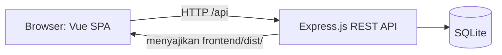
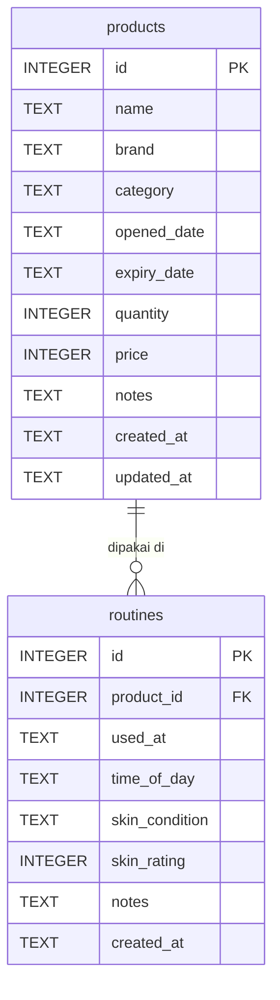

# Dokumen Proyek 1: Skincare Routine & Inventory Tracker

**Mata kuliah:** Pengembangan Aplikasi Berbasis Web (PABWE)
**Nama / NIM:** _(isi)_
**Repository GitHub:** _(isi URL)_
**URL aplikasi online:** _(isi URL dari Delcom)_
**Video demo YouTube:** _(isi URL)_

---

## 1. Latar Belakang

Perawatan kulit (skincare) kini menjadi bagian dari rutinitas banyak orang. Koleksi produk yang terus bertambah menimbulkan dua masalah praktis. Pertama, produk sering lupa dipantau sehingga dipakai melewati tanggal kedaluwarsa, padahal produk kedaluwarsa dapat memicu iritasi atau jerawat. Kedua, pengguna sulit mengetahui produk mana yang cocok untuk kulitnya karena reaksi kulit jarang dicatat secara teratur.

Catatan manual di buku atau galeri ponsel mudah hilang dan tidak memberi peringatan. Aplikasi web **Skincare Routine & Inventory Tracker** dibuat untuk menyatukan inventaris produk, pelacakan kedaluwarsa, dan jurnal kondisi kulit harian dalam satu tempat yang rapi dan mudah dipakai.

## 2. Deskripsi Aplikasi

### 2.1 Tujuan
- Mencatat seluruh produk skincare yang dimiliki.
- Memberi peringatan visual untuk produk yang segera atau sudah kedaluwarsa.
- Menyimpan jurnal pemakaian produk beserta kondisi kulit setelahnya.

### 2.2 Fitur utama
| Fitur | Penjelasan |
|---|---|
| Manajemen produk | Tambah, lihat, ubah, hapus produk (nama, merek, kategori, tanggal dibuka, tanggal kedaluwarsa, stok, harga, catatan) |
| Badge kedaluwarsa | Dihitung server (`days_left`): Masih aman, X hari lagi (30 hari terakhir), Sudah kedaluwarsa |
| Pencarian dan filter | Cari nama/merek, saring kategori, tampilkan hanya yang segera kedaluwarsa |
| Jurnal kulit | Catat produk yang dipakai, waktu (pagi/malam), kondisi kulit, nilai 1-5, dan catatan |
| Ringkasan | Total produk, segera kedaluwarsa, sudah kedaluwarsa, jumlah catatan jurnal |

### 2.3 Teknologi
| Lapisan | Teknologi |
|---|---|
| Back-end | Express.js (REST API), folder `backend/` |
| Database | SQLite (modul bawaan runtime) |
| Front-end | Vue.js 3 (Composition API), Vite, Scoped CSS, folder `frontend/` |
| Pengujian | Vitest + coverage v8 |
| CI/CD | GitHub, Jenkins, SonarQube, Trivy, Delcom |

### 2.4 Arsitektur



Proyek terdiri dari dua folder terpisah: `backend/` (Express.js + SQLite) dan `frontend/` (Vue.js). Pada produksi, Express menyajikan hasil build Vue (`frontend/dist/`) dan API dari satu server. Pada pengembangan, Vite menjalankan front-end dan meneruskan `/api` ke Express.

## 3. Skema Database

Relasi **one-to-many**: satu produk memiliki banyak catatan jurnal.



### Tabel `products`
| Kolom | Tipe | Keterangan |
|---|---|---|
| id | INTEGER PK | Auto increment |
| name | TEXT | Nama produk, wajib |
| brand | TEXT | Merek, wajib |
| category | TEXT | cleanser, toner, serum, moisturizer, sunscreen, mask, other |
| opened_date | TEXT | Tanggal dibuka (YYYY-MM-DD), opsional |
| expiry_date | TEXT | Tanggal kedaluwarsa (YYYY-MM-DD), wajib |
| quantity | INTEGER | Stok, minimal 0 |
| price | INTEGER | Harga dalam Rupiah |
| notes | TEXT | Catatan |
| created_at, updated_at | TEXT | Timestamp otomatis |

### Tabel `routines`
| Kolom | Tipe | Keterangan |
|---|---|---|
| id | INTEGER PK | Auto increment |
| product_id | INTEGER FK | Mengacu ke `products.id`, `ON DELETE CASCADE` |
| used_at | TEXT | Tanggal pemakaian (YYYY-MM-DD) |
| time_of_day | TEXT | morning atau night |
| skin_condition | TEXT | great, good, normal, dry, oily, breakout, irritated |
| skin_rating | INTEGER | Nilai 1 sampai 5, opsional |
| notes | TEXT | Jurnal bebas |
| created_at | TEXT | Timestamp otomatis |

Skrip lengkap ada di `backend/src/db/schema.sql`, dan dummy data (termasuk Wardah Facial Wash, Implora Sunscreen SPF 40++, dan Glowies Dreamy Moisturizer) ada di `backend/src/db/seed.sql`.

## 4. Endpoint API

Base URL `/api`. Format sukses `{ "success": true, "data": ... }`, format gagal `{ "success": false, "message": "...", "errors": [...] }`.

| Method | Endpoint | Fungsi | Status sukses |
|---|---|---|---|
| GET | /api/health | Cek status server | 200 |
| GET | /api/products | Daftar produk; query `category`, `search`, `expiring` | 200 |
| GET | /api/products/:id | Detail produk | 200 |
| POST | /api/products | Tambah produk | 201 |
| PUT | /api/products/:id | Ubah produk | 200 |
| DELETE | /api/products/:id | Hapus produk dan jurnalnya | 200 |
| GET | /api/products/:id/routines | Jurnal milik satu produk | 200 |
| GET | /api/routines | Daftar jurnal; query `date`, `time_of_day`, `product_id` | 200 |
| GET | /api/routines/:id | Detail jurnal | 200 |
| POST | /api/routines | Tambah jurnal | 201 |
| PUT | /api/routines/:id | Ubah jurnal | 200 |
| DELETE | /api/routines/:id | Hapus jurnal | 200 |

Kode error: `400` validasi gagal, `404` data tidak ditemukan, `500` kesalahan server.

**Contoh `POST /api/products`**
```json
{
  "name": "Wardah Facial Wash",
  "brand": "Wardah",
  "category": "cleanser",
  "opened_date": "2026-08-01",
  "expiry_date": "2027-08-01",
  "quantity": 1,
  "price": 25000,
  "notes": "Untuk pagi dan malam"
}
```

**Contoh `POST /api/routines`**
```json
{
  "product_id": 1,
  "used_at": "2026-10-22",
  "time_of_day": "morning",
  "skin_condition": "good",
  "skin_rating": 4,
  "notes": "Kulit terasa bersih dan tidak ketarik"
}
```

## 5. Desain UI/UX dan Aksesibilitas

### 5.1 Tema
Estetika **Coquette / Soft Girl**: palet pastel soft pink, peach, dan lilac; sudut membulat `border-radius: 15px`; border putus-putus (dotted) dan ornamen ✿ 🎀; font **Playfair Display** untuk judul dan **Poppins** untuk isi. Seluruh gaya ditulis dengan CSS murni (Scoped CSS per komponen) dan variabel CSS di `frontend/src/styles/global.css`.

### 5.2 Kontras warna (WCAG 2.0 AA)
Teks memakai warna gelap (dark plum) di atas latar pastel. Batas AA adalah 4,5:1 untuk teks normal. Semua pasangan di bawah dihitung dengan rumus luminans relatif WCAG.

| Teks | Latar | Rasio | Hasil |
|---|---|---|---|
| Dark plum `#3F1536` | Soft pink `#FFF5F8` (latar halaman) | 14,34 : 1 | Lulus AAA |
| Dark plum `#3F1536` | Putih `#FFFFFF` (kartu) | 15,31 : 1 | Lulus AAA |
| Dark plum `#3F1536` | Pink `#FDE4EC` | 12,75 : 1 | Lulus AAA |
| Dark plum `#3F1536` | Peach `#FFE9DE` | 13,09 : 1 | Lulus AAA |
| Dark plum `#3F1536` | Lilac `#EFE6FA` | 12,66 : 1 | Lulus AAA |
| Dark plum `#3F1536` | Pink `#F9C9DA` (tombol sekunder) | 10,49 : 1 | Lulus AAA |
| Plum `#5E2552` (teks sekunder) | Soft pink `#FFF5F8` | 10,56 : 1 | Lulus AAA |
| Putih | Rose `#8A2455` (tombol utama) | 8,52 : 1 | Lulus AAA |
| Putih | Plum `#5E2552` (tab aktif) | 11,28 : 1 | Lulus AAA |
| Hijau tua `#14532D` | Mint `#DDF3E6` (badge aman) | 7,83 : 1 | Lulus AAA |
| Cokelat tua `#7A2E0B` | Peach `#FFE4CC` (badge segera) | 7,75 : 1 | Lulus AAA |
| Maroon `#7F1230` | Pink `#FFD9E0` (badge kedaluwarsa, error) | 8,00 : 1 | Lulus AAA |
| Placeholder `#765A6D` | Putih (input) | 6,08 : 1 | Lulus AA |

### 5.3 Praktik aksesibilitas lain
- Bahasa halaman `lang="id"`, tautan "Lewati ke konten utama", landmark `header`, `main`, `nav`.
- Status kedaluwarsa tidak hanya berupa warna: selalu disertai ikon dan teks.
- Setiap input punya `<label>`; pesan error memakai `role="alert"`; hasil aksi memakai `role="status"`.
- Dialog memakai elemen `<dialog>` bawaan (fokus terkunci, tombol Esc menutup).
- Fokus keyboard terlihat jelas (outline 3px berwarna ungu tua, rasio 9,49 : 1 terhadap putih).
- Target sentuh minimal 44 px dan animasi dimatikan untuk pengguna `prefers-reduced-motion`.

## 6. Pengujian dan CI/CD

- **Pengujian:** Vitest (dijalankan dari root untuk backend dan frontend) menguji validasi, lapisan database, seluruh endpoint REST (termasuk cascade delete dan penanganan error), penyajian file statis, klien API, dan fungsi format di front-end. Laporan coverage (`coverage/lcov.info`) dibaca SonarQube.
- **Pipeline Jenkins:** Checkout, Install Dependencies, Test (coverage), Trivy Security Scan, SonarQube Analysis, Quality Gate, Package Application, Publish Application, Deploy Application ke Delcom.
- **Pemicu:** webhook GitHub, sehingga setiap `git push` menjalankan pipeline.

## 7. Penutup

Aplikasi memenuhi kebutuhan pencatatan inventaris skincare dan jurnal kulit dengan tampilan feminin yang tetap memenuhi standar kontras WCAG 2.0 AA. Pengembangan lanjutan yang mungkin: notifikasi kedaluwarsa, grafik tren kondisi kulit, dan autentikasi pengguna.
